# Sentinel — Intelligent Surveillance System

A real-time face recognition surveillance platform built as a Final Year Project at UTAR.
Multiple camera feeds are decoded, tracked and matched against an enrolled watchlist on a
single workstation GPU, and the result is streamed to a React operator console with live
alerts, an evidence archive and recognition analytics.

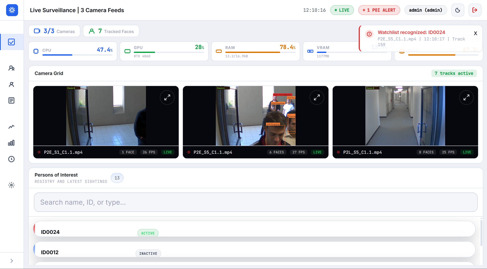

> Live Dashboard: three camera feeds under recognition, per-track bounding boxes and IDs,
> a watchlist alert, GPU/CPU/RAM telemetry and the persons-of-interest registry.
> Footage shown is from the academic [ChokePoint](http://arma.sourceforge.net/chokepoint/)
> dataset; identities are displayed as anonymised IDs.

---

## Contents

- [The problem](#the-problem)
- [What it does](#what-it-does)
- [System architecture](#system-architecture)
- [The recognition pipeline](#the-recognition-pipeline)
- [The enrolment pipeline](#the-enrolment-pipeline)
- [Data model](#data-model)
- [Security model](#security-model)
- [Tech stack](#tech-stack)
- [Project structure](#project-structure)
- [Getting started](#getting-started)
- [API overview](#api-overview)
- [The dashboard](#the-dashboard)
- [Engineering notes](#engineering-notes)
- [Limitations](#limitations)
- [Acknowledgements](#acknowledgements)

---

## The problem

Conventional CCTV is passive. An operator watching a wall of monitors cannot reliably notice
one person of interest crossing a corridor, and after the fact there is nothing to search —
only hours of undifferentiated video. Commercial face recognition suites that solve this are
closed, expensive, and assume a server rack.

Sentinel is an attempt at the same capability under realistic constraints: unconstrained
surveillance footage (off-angle, low resolution, motion blur, poor lighting), a single
consumer GPU, and a gallery enrolled from only a handful of photographs per person.

The engineering problem is not "run a face recognition model". It is deciding **which frames
deserve the expensive model at all**, and making the answer stable enough that an identity
label does not flicker between people as someone walks through frame.

## What it does

- **Live multi-camera monitoring** — per-camera worker threads decode RTSP streams or
  recorded files, run detection and tracking, and publish annotated MJPEG to the browser.
- **Watchlist recognition** — faces are matched against an enrolled gallery; a hit raises a
  real-time alert pushed over an authenticated WebSocket.
- **Quality-gated inference** — a face image quality model decides whether a candidate crop
  is worth embedding, so the recognition model is not spent on unusable faces.
- **Few-shot enrolment with augmentation** — a new person is enrolled from a small set of
  photographs, expanded by multi-view synthesis and environment simulation into a more
  robust template set.
- **Evidence archive** — every successful recognition is stored with its annotated snapshot,
  camera, timestamp and similarity score.
- **Face search** — upload a photo and retrieve visually similar enrolled identities.
- **Recognition analytics** — recognition rate, similarity distribution, accuracy by face
  size, activity timelines and weekday/hour heatmaps, per-camera and per-person breakdowns.
- **Audited access to sensitive images** — reference-photo views are logged per operator.

## System architecture

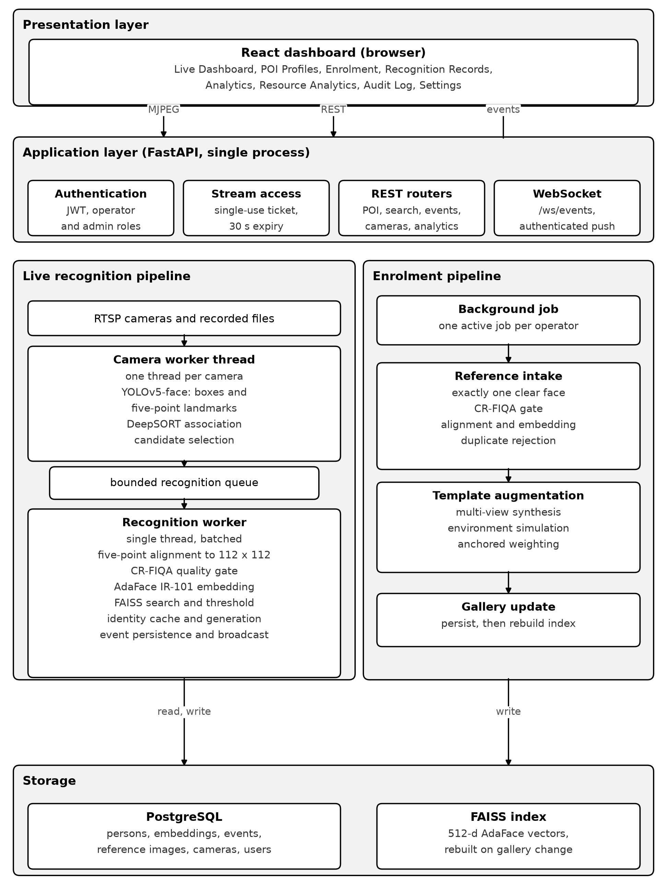

The backend is a **single FastAPI process**. That is a deliberate constraint, not an
oversight: the models occupy GPU memory once, and a multi-process deployment would either
duplicate them or require a model server, neither of which fits a single-GPU workstation.

Concurrency inside that process is split by responsibility:

| Component | Concurrency | Why |
| --- | --- | --- |
| Camera worker | one thread per camera | Decoding and detection are I/O- and GPU-bound; a stalled camera must not block the others. |
| Recognition worker | one thread, batched | Serialises GPU access so embedding batches stay efficient and VRAM stays bounded. |
| Recognition queue | bounded | Back-pressure. Under load the system drops candidates rather than growing an unbounded backlog and falling behind real time. |
| Enrolment job | background task | Augmentation takes seconds to minutes; the HTTP request returns `202` immediately. |
| FastAPI request handlers | async event loop | Everything blocking is pushed to a thread pool so the event loop keeps serving streams. |

## The recognition pipeline

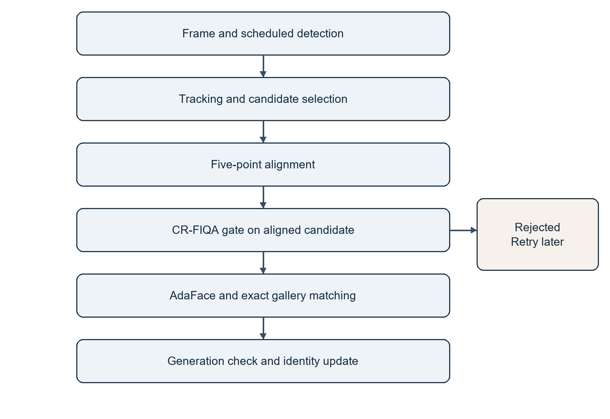

Each stage exists to avoid paying for the next one unnecessarily:

1. **Scheduled detection** — YOLOv5-face returns boxes *and* five-point landmarks in one
   pass, so no separate landmark model is needed. Detection runs on a schedule rather than
   every frame; tracking covers the gaps.
2. **Tracking and candidate selection** — DeepSORT associates detections into tracks. Rather
   than embedding every frame of a track, the pipeline collects a few spaced candidates per
   track and picks among them.
3. **Five-point alignment** — the candidate is warped to a canonical 112×112 crop. Alignment
   happens *before* quality assessment, because quality is measured on the image the
   recognition model will actually see.
4. **Quality gate (CR-FIQA)** — a cheap quality score decides whether to call the expensive
   model. Below threshold, the candidate is dropped and the track is retried later. This is
   the single biggest throughput lever in the system.
5. **Embedding and matching** — AdaFace IR-101 produces a 512-d vector, searched against a
   FAISS index of enrolled templates. A match must clear both an absolute similarity
   threshold and a margin between the best two *distinct identities* — not merely the best
   two templates, which would be trivially satisfied by two photos of the same person.
6. **Generation check and identity update** — before a label is committed, the pipeline
   verifies the track has not been invalidated since the candidate was queued.

### Identity stability

The hardest bug class here is not a missed face; it is a **wrong label that looks confident**.
Two mechanisms guard against it:

- **Generation counters.** A track carries a generation number. Missing a target on a
  scheduled detection cycle invalidates its cached identity and any in-flight recognition,
  even when the tracker keeps the same ID. Without this, a track that loses its subject and
  re-acquires a different person inherits the previous occupant's identity for the remainder
  of the identity-cache window.
- **Unknown events are recorded.** Detections that fail the threshold are persisted with a
  null identity. This matters for honesty as much as for analytics: if only successful
  matches are stored, recognition rate is trivially 100% and the similarity distribution is
  truncated at the cut-off.

## The enrolment pipeline

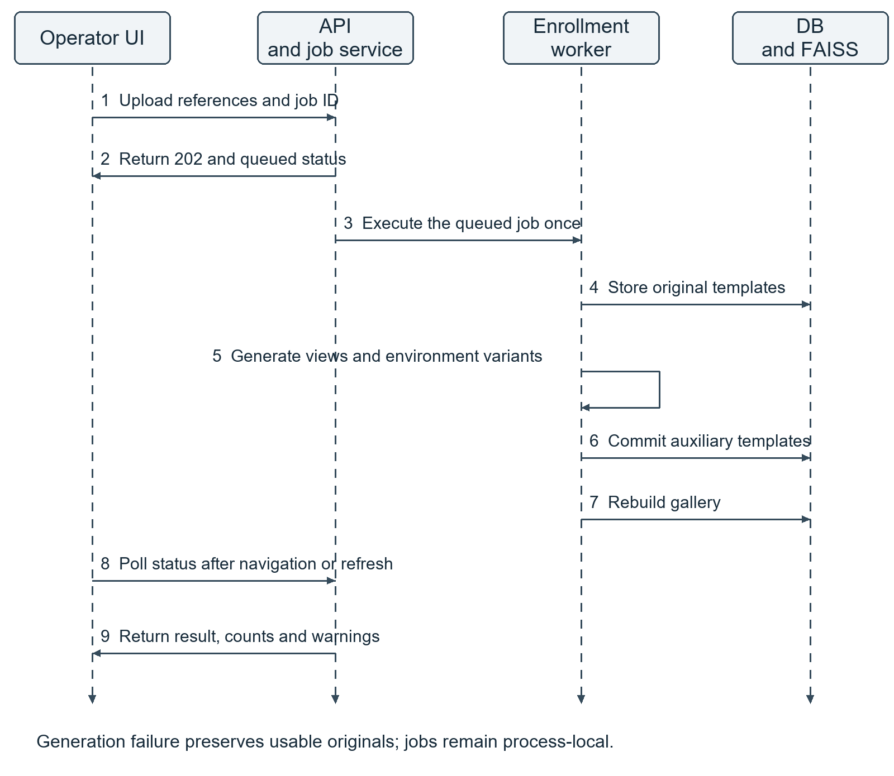

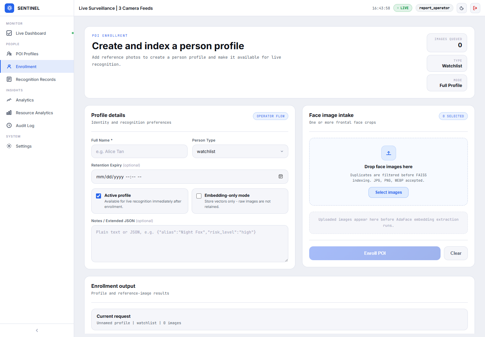

Recognising someone from a handful of enrolment photographs is the core difficulty: the
gallery is studio-like, the probe is a corridor camera. The enrolment pipeline closes part of
that gap before matching ever happens.

- **Intake** requires exactly one clear face per reference image, gated by the same quality
  model used at inference, and rejects duplicates of an existing identity.
- **Template augmentation** expands each accepted reference through multi-view synthesis and
  environment simulation, producing templates nearer to the pose and lighting the cameras
  actually deliver. Synthesised templates are anchored — weighted against the original — so
  augmentation cannot drift the identity away from the real face.
- **Gallery update** persists templates and rebuilds the FAISS index.

Enrolment runs as a background job: one active job per operator, a bounded pending queue, and
a status endpoint the UI polls. Jobs are in-memory and do not survive a backend restart; the
UI asks the operator to verify the person list after a job goes missing.

## Data model

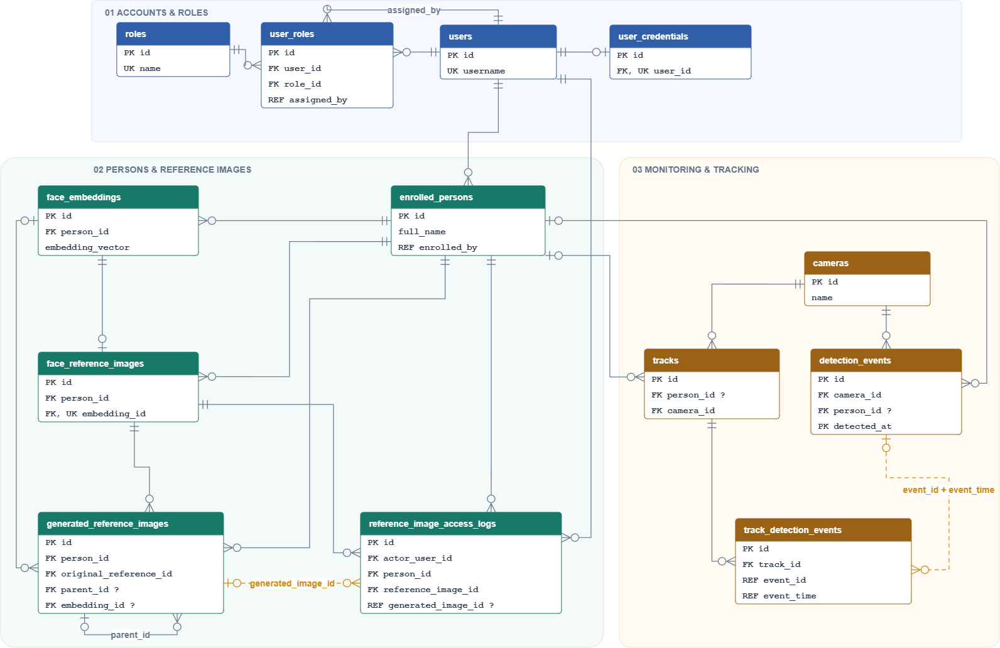

Four areas: accounts and roles; enrolled persons with their reference images and embeddings;
monitoring (cameras, tracks, detection events); and the audit trail for sensitive-image access.
Generated reference images keep a parent link back to the original photograph, so an augmented
template can always be traced to the source it was derived from.

The full schema is in [`docs/schema.sql`](docs/schema.sql).

## Security model

Surveillance data is sensitive by definition, so access control is part of the system rather
than an afterthought.

- **JWT authentication** with operator and administrator roles. Operational endpoints — POIs,
  cameras, search, events, counts, tracks, embedding statistics, resources — all require a
  bearer token. Only health and authentication entry points are public.
- **Single-use stream tickets.** A browser `` tag cannot send an `Authorization` header,
  so MJPEG streams are not protected by one. Instead the client exchanges its token for a
  camera-bound, random, 30-second single-use ticket. The ticket does not contain the JWT.
  Open streams terminate at login expiry and re-check account status periodically.
- **Authenticated WebSocket.** `/ws/events` accepts a connection but subscribes it only after
  a valid `authenticate` message within five seconds; expiry is re-checked while connected.
- **Scope separation.** Sensitive-image scope tokens cannot be replayed as general login
  tokens, and viewing a protected reference photo additionally requires password re-entry.
- **Audit logging.** Every reference-image view is attributed to an operator.

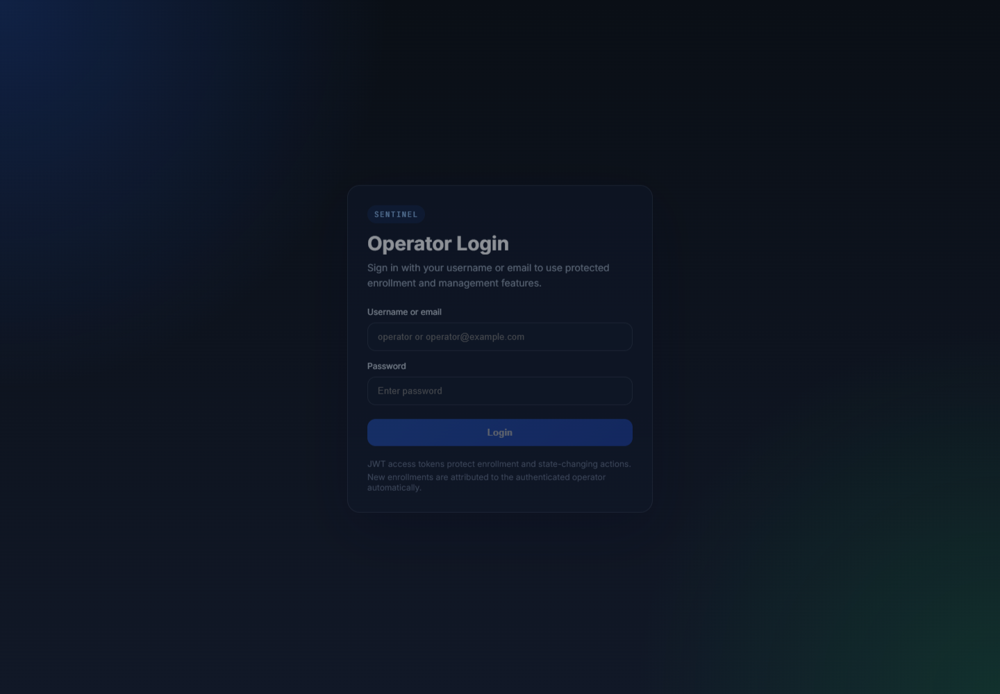

## Tech stack

**Backend** — Python, FastAPI, Uvicorn, SQLAlchemy, PostgreSQL, FAISS, PyTorch,
ONNX Runtime (GPU), OpenCV, NumPy/SciPy/scikit-image.

**Models** — YOLOv5-face (detection + 5-point landmarks, ONNX), DeepSORT (tracking),
InsightFace `buffalo_sc` (alignment), CR-FIQA(S) (face image quality), AdaFace IR-101
trained on WebFace12M (recognition).

**Frontend** — React 18, Vite. No charting library: every chart is hand-built on the
project's own CSS variables, so the visual system stays consistent and the bundle stays small.

## Project structure

```
sentinel-backend/
  app/
    api/            FastAPI routers, dependencies, stream access tickets
    core/           config, database, security, logging, WebSocket manager
    models/         SQLAlchemy entities and Pydantic schemas
    repositories/   data access per aggregate
    services/       detection, tracking, alignment, quality, recognition,
                    enrolment, augmentation, analytics, resources
  main.py           uvicorn entry point
  requirements.txt

sentinel-dashboard/
  src/
    components/     camera grid, event log, POI panel, photo search, charts
    pages/          dashboard, enrolment, profiles, records, analytics, settings
    hooks/          websocket, resources, analytics, preferences
    context/        authentication
    utils/          API client, live socket

docs/
  images/           architecture, pipeline, ERD and UI figures
  schema.sql        full database schema
```

## Getting started

### Prerequisites

- Python 3.11
- Node.js 18+
- PostgreSQL 14+
- An NVIDIA GPU with CUDA. Developed and measured on an RTX 4060 (8 GB).

### Model weights

Weights are **not** in this repository. Download them and point the environment variables at
your copies:

| Model | Variable |
| --- | --- |
| YOLOv5-face (ONNX) | `SENTINEL_DETECTION_MODEL_PATH` |
| AdaFace IR-101 WebFace12M | `SENTINEL_RECOGNITION_MODEL_PATH` |
| CR-FIQA(S) backbone | `SENTINEL_FACE_QUALITY_MODEL_PATH` |

The InsightFace `buffalo_sc` alignment pack is fetched automatically on first run.

### Backend

```bash
cd sentinel-backend
python -m venv venv && source venv/bin/activate   # Windows: venv\Scripts\activate
pip install -r requirements.txt
pip install --no-deps -r requirements-nodeps.txt
```

Both install steps are required. Running only the first leaves the application working but
roughly **5× slower**, with no error and no traceback — see the comments in
`requirements-nodeps.txt` for why.

Copy the environment template and edit it:

```bash
cp .env.example .env
```

At minimum set `SENTINEL_DATABASE_URL` and a real `SENTINEL_JWT_SECRET`. Then:

```bash
uvicorn main:app --host 0.0.0.0 --port 8000 --ws-per-message-deflate false
```

Keep `--ws-per-message-deflate false`: camera frames are JPEGs, which do not compress, and
uvicorn would otherwise deflate every frame on the event loop.

### Dashboard

```bash
cd sentinel-dashboard
npm install
npm run dev
```

### Tuning

`.env.example` documents every threshold with the reasoning behind its default — detection
confidence, recognition threshold, the identity margin, separate quality gates for enrolment
and live inference, candidate collection windows and cooldowns. The defaults are the values
the system was evaluated at; they are a starting point, not universal constants.

## API overview

| Group | Purpose |
| --- | --- |
| `/health`, `/api/resources` | Liveness and GPU/CPU/RAM telemetry |
| `/api/auth/*` | Login, logout, current user, password change |
| `/api/stream/{id}`, `/api/stream/{id}/ticket` | MJPEG video and single-use stream tickets |
| `/api/counts`, `/api/fps`, `/api/tracks/active` | Live pipeline statistics |
| `/ws/stream/{id}`, `/ws/events` | Frame and event push over WebSocket |
| `/api/cameras/*` | Camera registration and activation |
| `/api/poi/*` | Enrolment, profiles, reference images, enrolment jobs |
| `/api/search`, `/api/embeddings/stats` | Photo-to-identity search, gallery statistics |
| `/api/events`, `/api/recognition-records/*` | Event log and evidence archive |
| `/api/analytics/*` | Summary, timeline, similarity histogram, face-size quality, per-camera, top persons |
| `/api/settings/*` | Camera and recognition configuration |

Interactive documentation is served at `/docs` once the backend is running.

## The dashboard

| | |
| --- | --- |
| 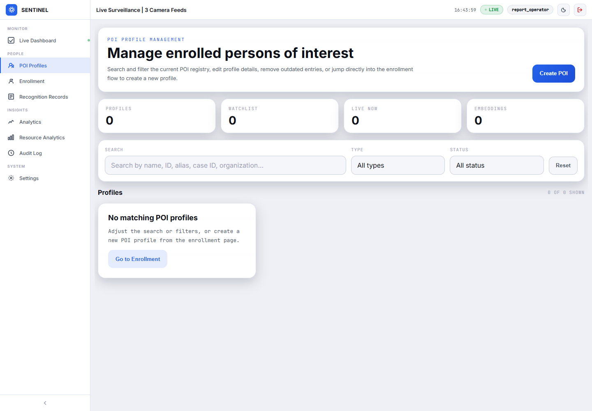 | 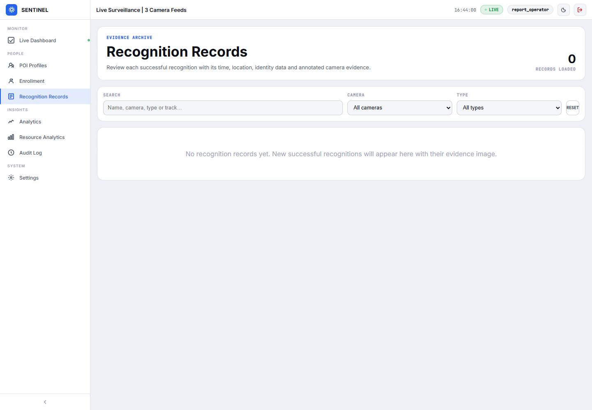 |
| **POI Profiles** — the enrolled registry, searchable and filterable by type and status. | **Recognition Records** — the evidence archive; each successful match with its annotated snapshot. |
| 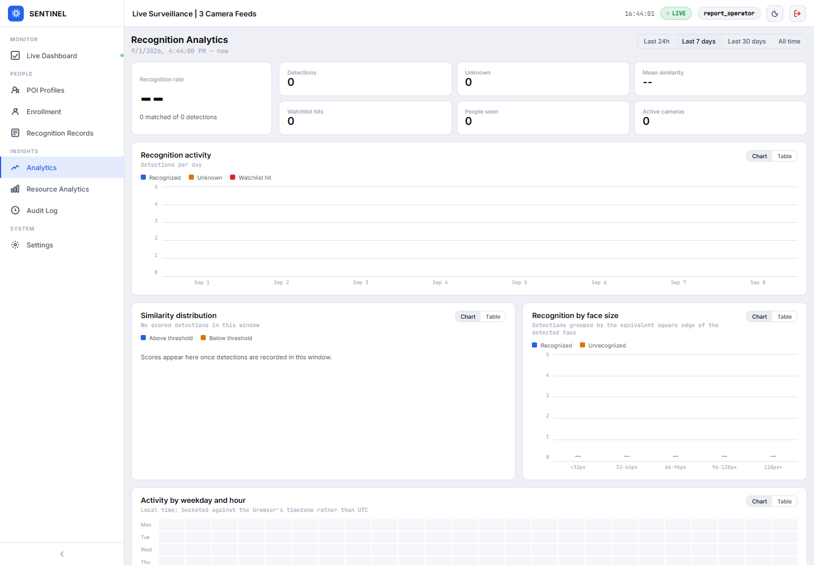 | 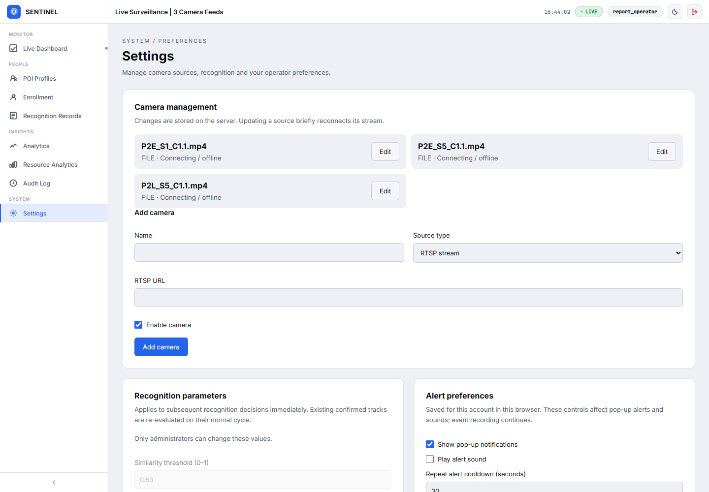 |
| **Analytics** — recognition rate, similarity distribution, accuracy by face size, activity heatmap. | **Settings** — cameras, administrator-only recognition parameters, alert and theme preferences. |

Every chart ships a legend, a table view and keyboard-reachable readouts, so no value is
available by colour alone. Series colours were selected for separation under protanopia and
tritanopia as well as normal vision.

## Use cases

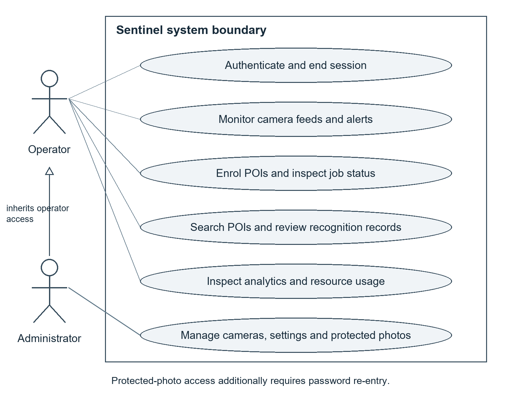

## Engineering notes

A few decisions worth calling out, because they are the ones that took the longest to get
right:

- **Analytics bucketing happens in Python, not SQL.** SQLite and PostgreSQL disagree on
  truncation, on how `CAST(... AS INTEGER)` rounds, and on whether `sqrt()` exists. Doing it
  in SQL would silently place rows in different buckets depending on the backend.
- **Events are stored in UTC, reported in local time.** "Activity by hour of day" is only
  meaningful locally, so every analytics endpoint takes a timezone offset and aligns bucket
  boundaries and heatmap cells to it.
- **A sentinel similarity of `-1.0` means "no score available".** Every average over
  similarity filters those rows out rather than letting them drag the mean below zero.
- **`person_id IS NULL` is what distinguishes an unknown detection from a match** — the
  discriminator used consistently across the analytics layer.
- **Alerts are reserved for identified subjects.** Once unknown detections began to be
  recorded, an unfiltered toast rule would have popped a notification for every passer-by.

## Limitations

This is a Final Year Project, and the scope is honest about it:

- Single-workstation deployment. There is no horizontal scaling story.
- Enrolment jobs are in-memory and do not survive a backend restart.
- Recognition thresholds are tuned for the evaluation footage; a different camera placement
  will need re-tuning.
- Evaluation harnesses, benchmark scripts and the test suite are kept in a separate private
  repository and are not included here.

## Acknowledgements

This project builds directly on published research and open models:

- [AdaFace](https://github.com/mk-minchul/AdaFace) — quality-adaptive margin face recognition.
- [CR-FIQA](https://github.com/fdbtrs/CR-FIQA) — face image quality assessment.
- [YOLOv5-face](https://github.com/deepcam-cn/yolov5-face) — joint face detection and landmarks.
- [InsightFace](https://github.com/deepinsight/insightface) — alignment model packs.
- [FAISS](https://github.com/facebookresearch/faiss) — similarity search.
- [ChokePoint](http://arma.sourceforge.net/chokepoint/) — the surveillance dataset used for
  development and evaluation.

Developed as a Final Year Project at Universiti Tunku Abdul Rahman (UTAR).
